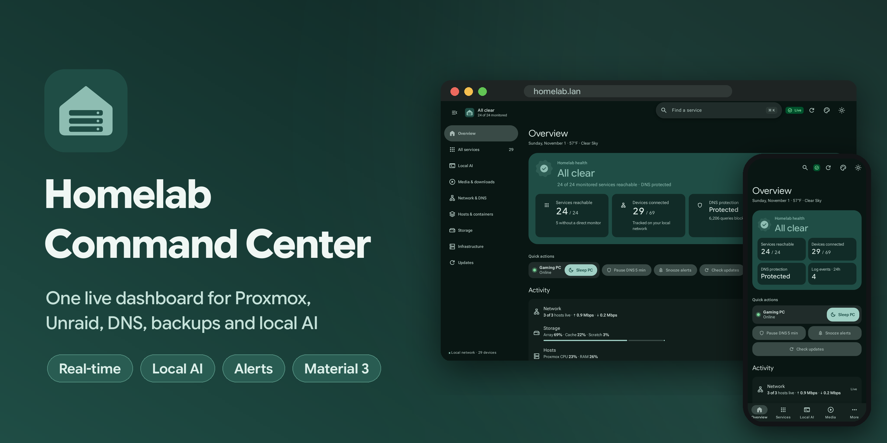
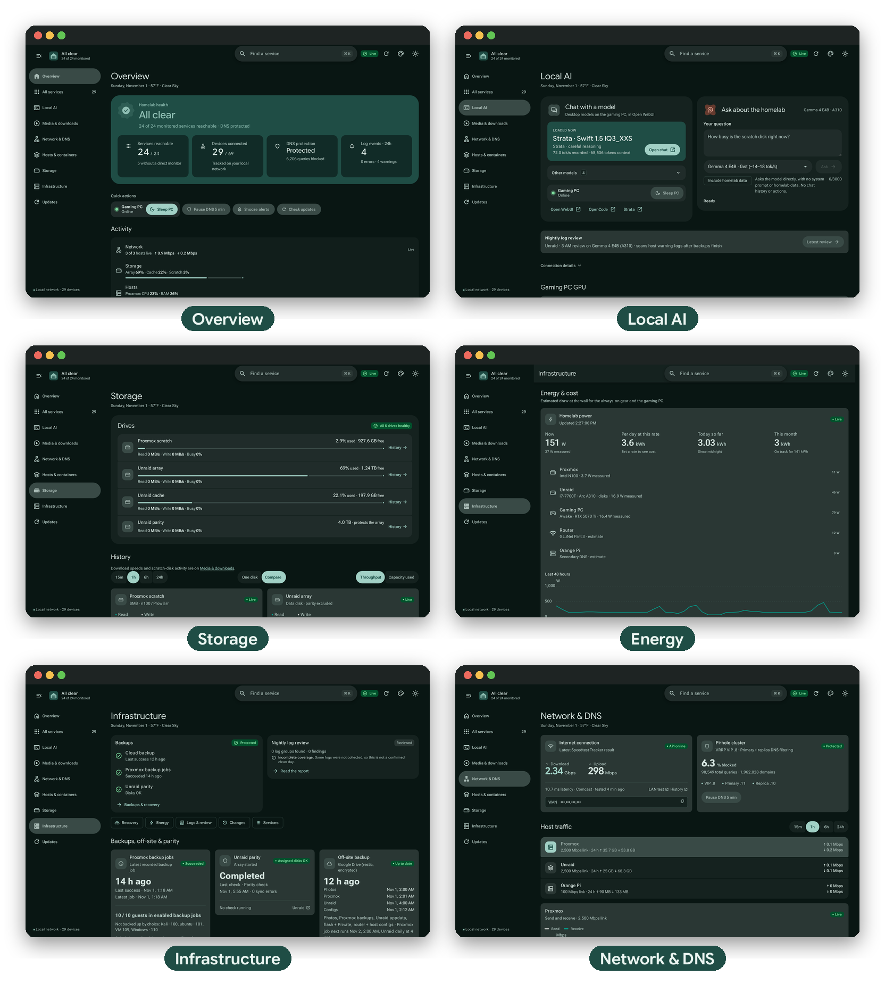
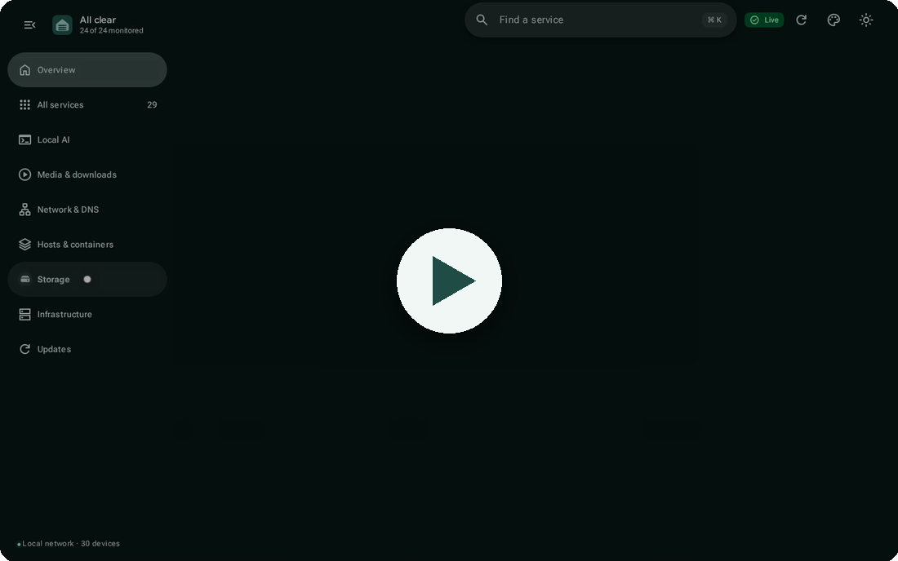
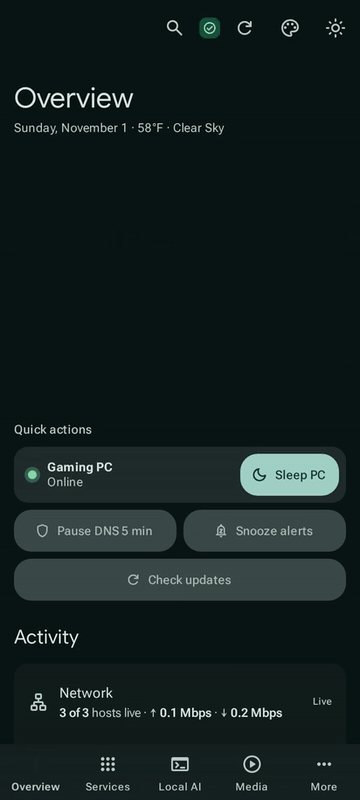
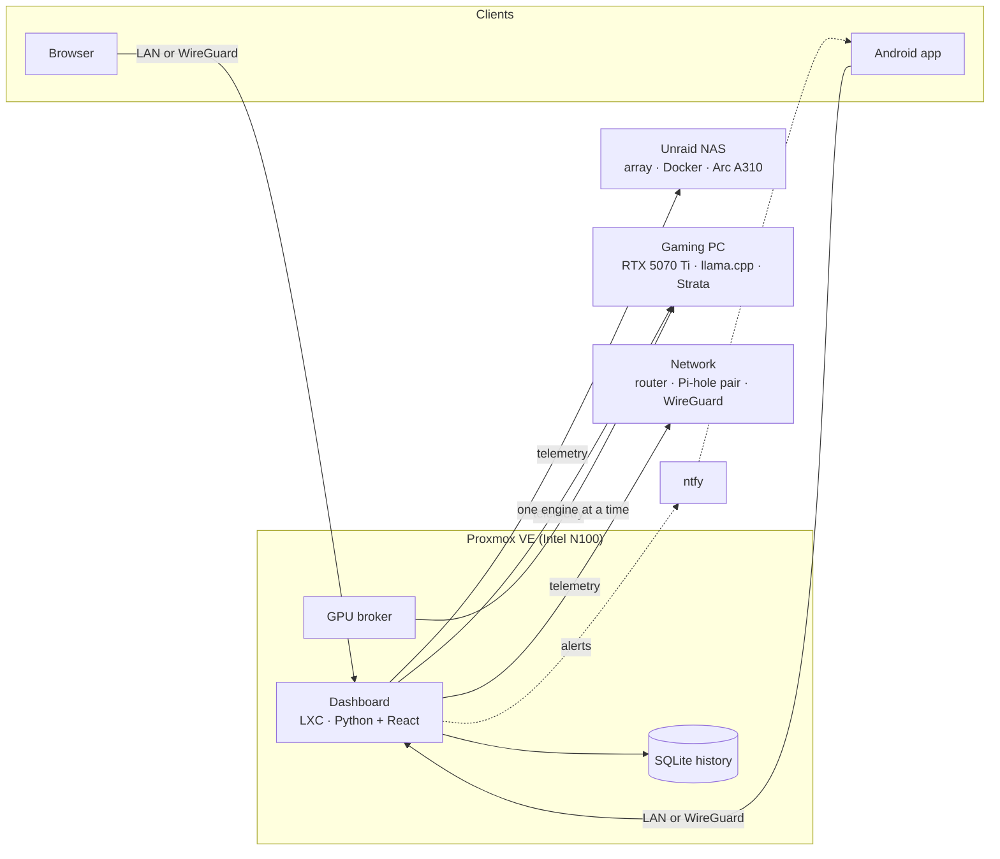

<div align="center">



<h1>Homelab Command Center</h1>

**A live dashboard and telemetry service for a Proxmox and Unraid home lab.**
The first screen says whether anything needs attention; dedicated pages cover services, storage, network, backups, energy, updates and local AI.

[](LICENSE)
[](#tech-stack)
[](#tech-stack)
[](#architecture)
[](#features)
[](https://github.com/roneill2000/homelab-android)

[Features](#features) · [Architecture](#architecture) · [Security](#security) · [Development](#development) · [Android app](https://github.com/roneill2000/homelab-android)

</div>

<p align="center">
  
</p>

---

## Features

| | |
|---|---|
| **Health & actions** | An immediate status ("All clear" or an attention list) with health tiles that open their page, quick actions (wake or sleep the gaming PC, pause Pi-hole, snooze alerts, check updates), a live activity card and pinned services. Wake and sleep are idempotent: waking a PC that is already on just reports success. |
| **Alerts** | One private ntfy topic. Notifications open the app on the right page, carry a *Snooze 2 h* button, and a recovery replaces its alert. Snoozing holds new alerts and sends them afterwards if the problem is still there. |
| **Storage & network** | Real-time throughput, disk latency, SMART health and 24 h rolling history in SQLite. Predicts Unraid cache fills and runs the mover before they happen. |
| **Local AI** | Four llama.cpp models on an RTX 5070 Ti (one with vision) plus Strata, a 177B mixture-of-experts model streamed from NVMe. A GPU broker gives every client one address and swaps engines on demand, so only one is ever loaded, and never while a game is running. Every request is logged with its swap time and speeds; live GPU power, temperature, load and VRAM come from a tiny on-demand reader on the PC. The Ask box sends just the question unless you include homelab data, and a model on an Arc A310 runs the nightly log review. |
| **Energy** | Measured CPU, Arc A310 and RTX 5070 Ti power plus labelled estimates for everything else, hourly totals kept for 400 days, and optional cost from a private electricity rate. |
| **Updates & backups** | Container `apt` upgrades and Docker image pulls with automatic rollback snapshots. Tracks Proxmox backup jobs and off-site restic snapshots. |
| **Media** | Now playing on Jellyfin (who, what, direct play or transcode and why, time left) and manual downloads. |
| **Any screen** | Adapts from phones (bottom bar and More sheet) to ultrawides. Material 3 Expressive motion and colour tokens generated from one seed colour you can change, or, in the app, from the phone's wallpaper. Charts open larger with pinch, drag-to-select and scroll zoom. |

### In motion

<p align="center">
  <a href="showcase/motion-desktop.mp4"></a>
  &nbsp;&nbsp;
  
</p>
<p align="center">
  <a href="showcase/motion-desktop.mp4">Desktop walkthrough (MP4)</a> · <a href="showcase/motion-desktop.gif">GIF</a> · <a href="showcase/motion-phone.mp4">Phone (MP4)</a> · <a href="showcase/Homelab_Command_Center_Showcase.pdf">9-page showcase PDF</a>
</p>

On a phone, the [**Homelab Android app**](https://github.com/roneill2000/homelab-android) adds Quick Settings tiles, a home-screen widget, predictive back, share-to-Ask and notifications.

---

## Architecture



- **Read-only by default.** Every page is built from telemetry the backend collects in the background; the browser never talks to the servers directly.
- **One switch for the GPU.** Clients (Open WebUI, OpenHands, the Ask box) all use the broker's address; it loads the requested engine, unloads the other, and refuses while a game is running.

---

## Security

- Runs on the local network and WireGuard only; nothing is exposed to the internet.
- State-changing actions require confirmation, a same-origin request and an `X-Dashboard-Action` header.
- Content-Security-Policy with per-request nonces; embedded telemetry data is escaped.
- The page can't be framed by other sites, requests for unknown host names are refused (DNS rebinding), and idle connections time out.
- The syslog monitor serves only its own page and the dashboard: no cross-site reads, no cross-site clearing, and log names are limited to real hosts.
- The update runner uses a locked-down SSH key accepted only from the dashboard host.
- The GPU broker refuses cross-site requests, unknown host names and malformed generation requests, and shares one lock with the dashboard's engine switch.
- No secrets or API keys are stored in the repository or sent to the browser.

---

## Tech stack

| Layer | Built with |
|---|---|
| Front end | React 18, bundled by esbuild into a single `index.html`; Material 3 Expressive tokens generated from one seed colour; Google Sans Flex and Material Symbols, self-hosted |
| Back end | Python 3 standard library only: a threaded HTTP server plus collector modules for storage, network, activity, GPU, AI, logs and energy |
| Data | SQLite for rolling metrics, hourly energy and AI request history |
| Tests | Playwright check suites for the UI and a Python `unittest` suite for the back end |

---

## Development

Requires Node.js 18+ and Python 3.10+.

```sh
npm ci
npm run build          # writes index.html
python3 scripts/preview.py   # local preview on 127.0.0.1:8799
npm run check          # confirms index.html matches a fresh build, then the Playwright check suites
npm test               # back-end unit tests (tests/ and syslog/)
```

Refresh the showcase screenshots, PDF and clips (requires `ffmpeg`):

```sh
node showcase/build-showcase.mjs   # screenshots + PDF
node showcase/record-motion.mjs    # desktop and phone clips
```

### Repository layout

| Folder | What lives there |
|---|---|
| `src/` | React app and styles (bundled by `build.mjs` into `index.html`) |
| `backend/` | Python modules the dashboard host runs: monitors, proxies, the GPU broker, the server patches |
| `scripts/` | Tools run by hand: `deploy.py`, `preview.py`, installers and one-off configurators |
| `tests/`, `checks/` | Python unit tests and Playwright check suites |
| `nightly/`, `alerts/`, `updates/`, `pc/`, `systemd/`, ... | Services that run on other hosts, and their installers |
| `docs/`, `handoffs/` | Plans, findings and session notes |

## Deployment

Runs in a Proxmox LXC under systemd (`homelab-dashboard.service`):

```sh
python3 scripts/deploy.py
```

`scripts/deploy.py` backs up the current files, updates `index.html` and the back-end patches, checks syntax and API health, and rolls back on failure.

---

## License

[MIT](LICENSE)
