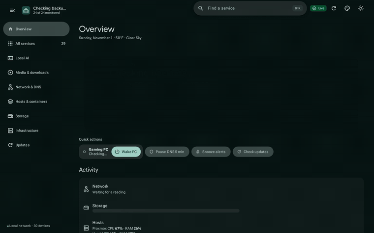
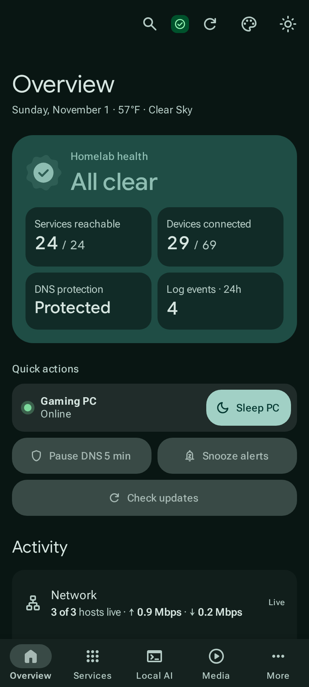
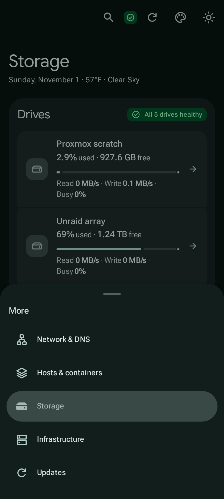

# Homelab Command Center

A React dashboard and telemetry service for a Proxmox and Unraid homelab. The first screen shows whether anything needs attention; dedicated pages cover services, storage, network, backups, energy, updates, and local LLMs.



Sharper copies: [desktop MP4](showcase/motion-desktop.mp4), [phone MP4](showcase/motion-phone.mp4). The 9-page showcase PDF is at [`showcase/Homelab_Command_Center_Showcase.pdf`](showcase/Homelab_Command_Center_Showcase.pdf).

## Features

- **Health & Actions:** Immediate status ("All clear" or attention list) with health tiles that open their page, quick actions (wake/sleep gaming PC, pause Pi-hole, snooze alerts, check updates), a live activity card, and pinned services. Wake and sleep are idempotent: waking a PC that is already on just reports success.
- **Alerts:** One private ntfy topic. Notifications open the app on the right page, carry a Snooze 2 h button, and a recovery replaces its alert. Snoozing holds new alerts and sends them afterwards if the problem is still there.
- **Storage & Network:** Real-time throughput, disk latency, SMART health, and 24h rolling history in SQLite. Predicts Unraid cache fills and runs the mover proactively.
- **Local AI:** Four llama.cpp models on the RTX 5070 Ti (one with vision) plus Strata, a 177B mixture-of-experts model streamed from NVMe. A GPU broker (`gpu_broker.py`) gives every client one address and swaps engines on demand, so only one is ever loaded, and never while a game is running. Every request is logged with its swap time and speeds. Live GPU power, temperature, load and VRAM come from a tiny on-demand reader on the PC (`pc/gpu_metrics.py`). The Ask box sends just the question unless you include homelab data; a Gemma model on an Arc A310 runs the nightly log review.
- **Energy:** Measured CPU, Arc A310 and RTX 5070 Ti power plus labelled estimates for everything else, hourly totals kept for 400 days, and optional cost from a private electricity rate.
- **Updates & Backups:** Container `apt` upgrades and Docker image pulls with automatic rollback snapshots. Tracks Proxmox backup jobs and Google Drive restic snapshots.
- **Media:** Now playing on Jellyfin (who, what, direct play or transcode and why, time left) and manual downloads through Prowlarr.
- **Mobile & Responsive:** Adapts from phones (bottom bar + More sheet) to ultrawides. Follows Material 3 Expressive motion and color tokens, generated from one seed colour you can change (or, in the app, the phone's wallpaper). Charts open larger with pinch, drag-to-select and scroll zoom. The [Android app](https://github.com/roneill2000/homelab-android) wraps it with predictive back, haptics, share-to-Ask and notifications.

<p align="center">
  
  &nbsp;
  
  &nbsp;
  
</p>

## Development

Requires Node.js 18+ and Python 3.10+.

```sh
npm ci
npm run build          # writes index.html
python3 preview.py     # local preview on 127.0.0.1:8799
npm run check          # confirms index.html matches a fresh build, then 15 Playwright check suites
python3 -m unittest discover -v
```

To refresh the showcase screenshots, PDF, and clips (requires `ffmpeg`):

```sh
node showcase/build-showcase.mjs   # screenshots + PDF
node showcase/record-motion.mjs    # desktop and phone clips
```

## Deployment

Runs in a Proxmox LXC under systemd (`homelab-dashboard.service`):

```sh
python3 deploy.py
```

`deploy.py` backs up current files, updates `index.html` and backend patches, checks syntax and API health, and rolls back on failure.

## Security

- Runs on the local network/VPN only.
- State-changing actions require confirmation, a same-origin request, and an `X-Dashboard-Action` header.
- Content-Security-Policy with per-request nonces; embedded telemetry data is escaped.
- The page can't be framed by other sites, requests for unknown host names are refused (DNS rebinding), and idle connections time out.
- The syslog monitor serves only its own page and the dashboard: no cross-site reads, no cross-site clearing, and log names are limited to real hosts.
- Update runner uses a locked-down SSH key accepted only from the dashboard host.
- The GPU broker refuses cross-site requests, unknown host names and malformed generation requests, and shares one lock with the dashboard's engine switch.
- No secrets or API keys are stored in the repo or sent to the browser.

## License

MIT
