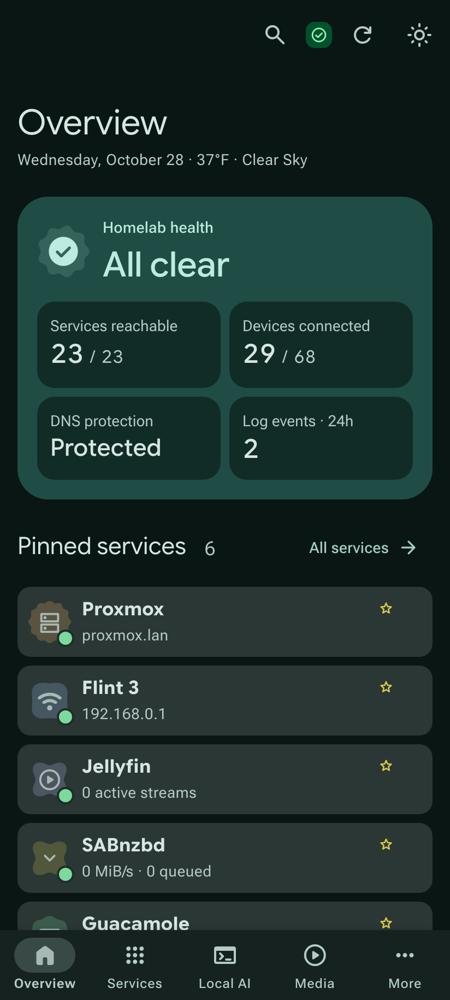
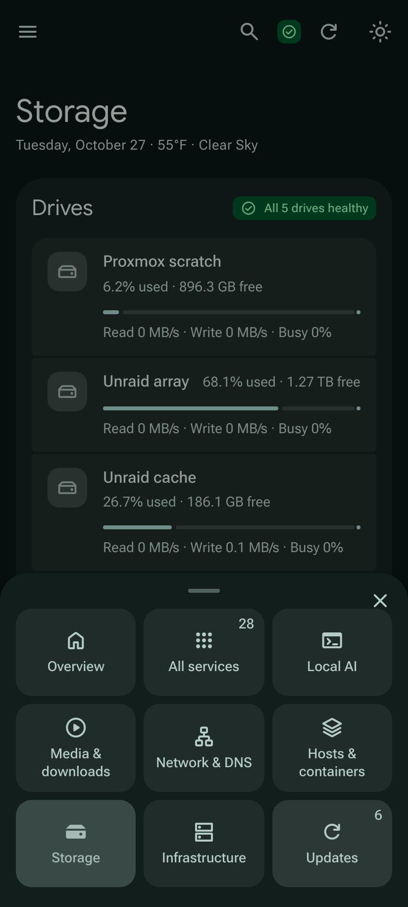
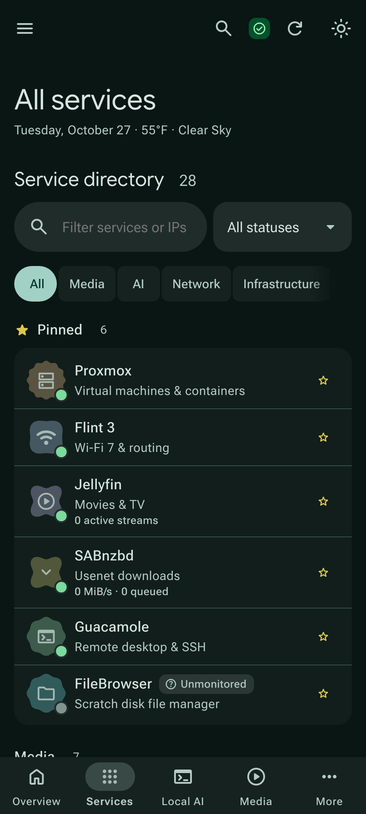
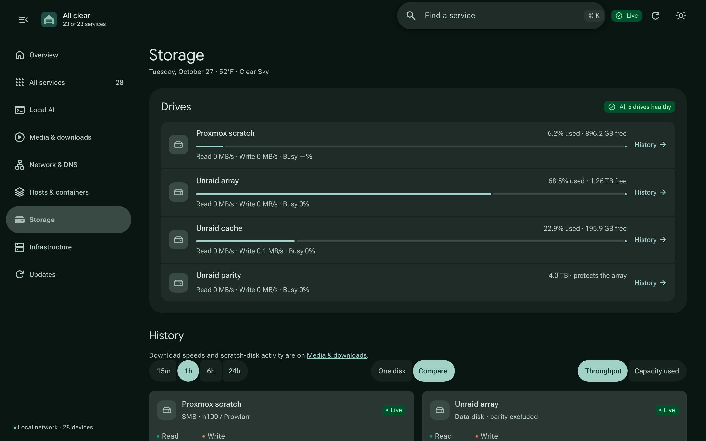
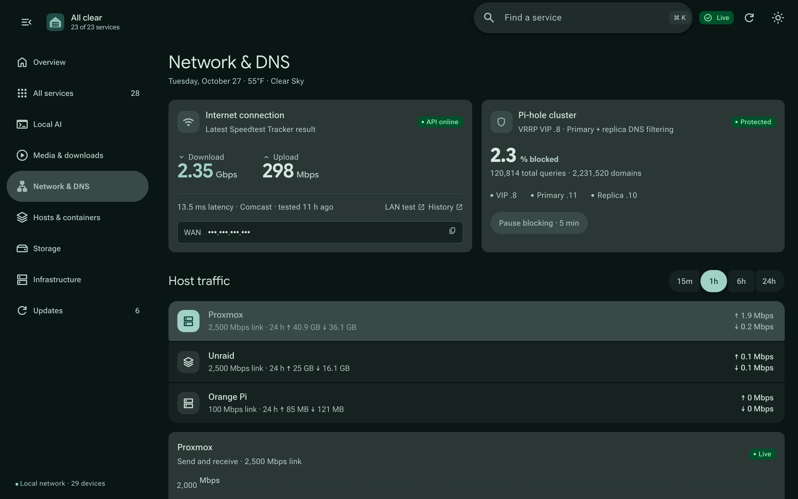
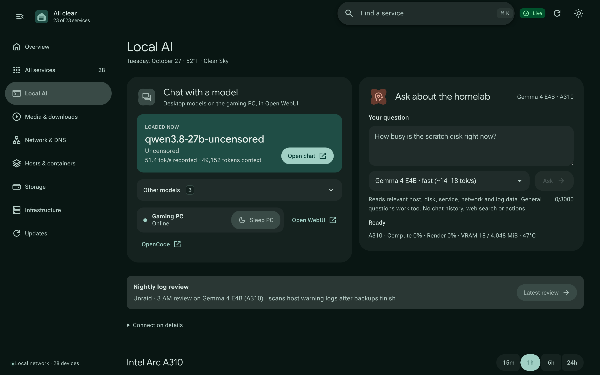
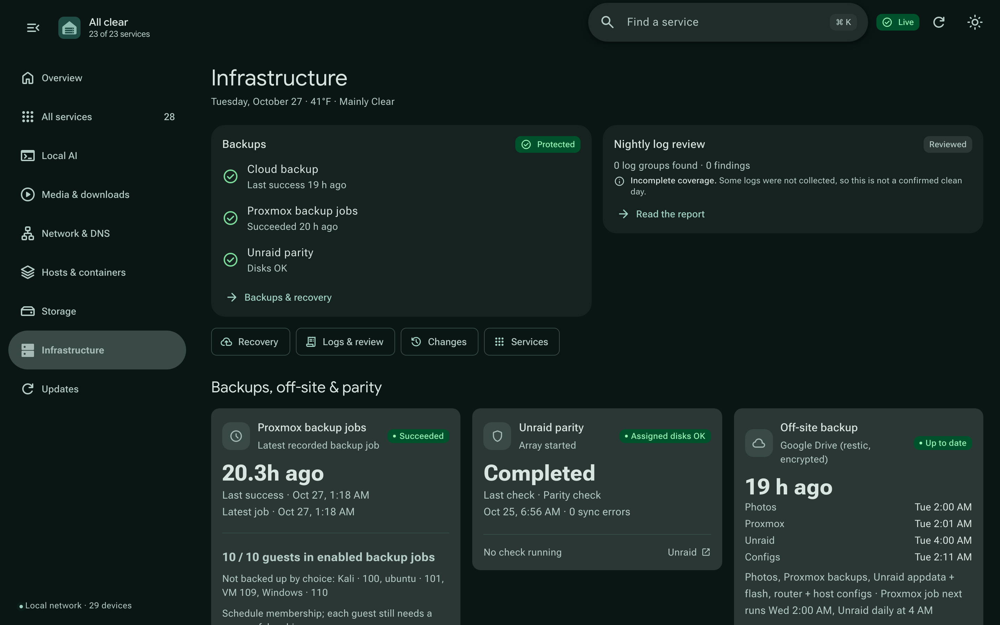
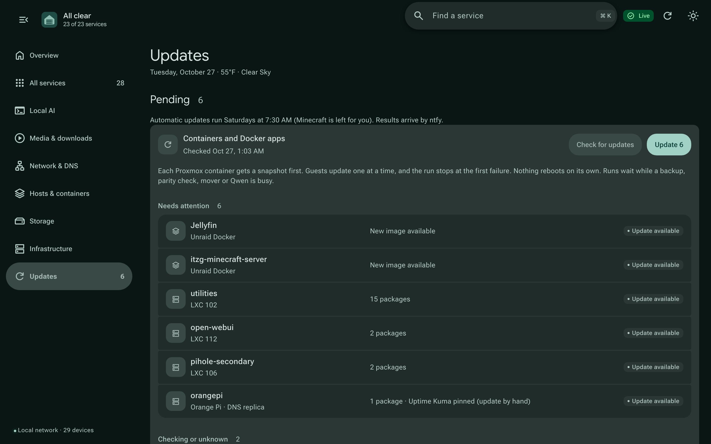
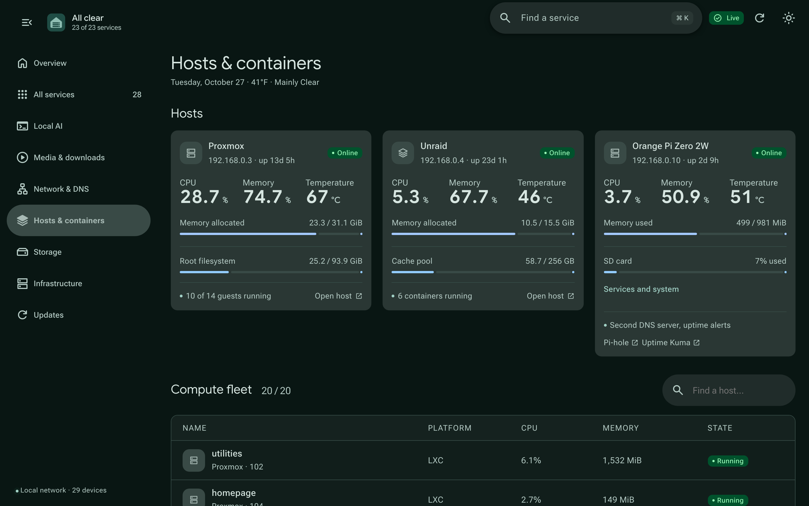

# Homelab Command Center

A React dashboard and telemetry service for a Proxmox and Unraid homelab. The first screen says whether anything needs attention. The other pages cover services, disks, network, backups, updates and the local AI models.

The 8-page showcase is at [`showcase/Homelab_Command_Center_Showcase.pdf`](showcase/Homelab_Command_Center_Showcase.pdf). High-definition video walkthrough is available at [`showcase/demo.mp4`](showcase/demo.mp4).


## What it does

- **Overview.** A health card that reads "All clear" or lists what needs attention, with each item linking to its page. Pinned services and quick actions (wake or sleep the gaming PC, pause DNS blocking, check for updates) come next, then backup status and recent activity. On a phone, the health card and four pinned services fit on the first screen.
- **Services.** 28 self-hosted services grouped by category, with live reachability checks. Unreachable, stale and unmonitored services are labelled in text as well as colour.
- **Storage.** Free space, read and write rates, latency and SMART health for each drive, plus 24 hours of history. A forecast estimates when the Unraid cache will fill and starts the mover before it does. Parity shows its drive size and health, since it has no filesystem to measure.
- **Network.** The latest speed test, both Pi-hole DNS servers, and send and receive rates for each host, with one host's history charted at a time.
- **Local AI.** The model loaded on the gaming PC (RTX 5070 Ti, llama.cpp) comes first with an Open chat button, next to Wake and Sleep controls. A small Gemma model on the Arc A310 answers questions about the homelab and lists the readings it used. Arc A310 usage and history sit below.
- **Backups and recovery.** Proxmox backup jobs, the off-site restic copy in Google Drive and Unraid parity, with restore test results underneath. A nightly job on the A310 reviews host warning logs after the backups finish.
- **Updates.** `apt` upgrades for Proxmox containers and image updates for Unraid Docker apps. Each container is snapshotted first, guests update one at a time, and a failure stops the run and shows the rollback command.
- **Hosts and containers.** Proxmox, Unraid and the Orange Pi, then CPU, memory and state for every VM, container and Docker app.
- **Alerts.** ntfy push notifications for stale shares, failed services, stopped Docker apps, failed updates, stale speed tests, filling storage, drive health and backups.

Readings carry a timestamp. If a source stops answering, its tile shows a dash instead of zero.

## Design

The interface follows Material 3 Expressive, Google's 2025 update to Material Design. Colours are generated with Google's Material colour library from a single seed colour, for both light and dark themes. Navigation adapts to the window: a bottom bar with a More sheet on phones, a rail on tablets, and a collapsible rail on desktops.

Shapes and motion come from the Expressive spec. The health icon sits in a scalloped shape that changes when something is wrong, each service category has its own icon shape, and the loading indicator morphs between shapes. Pages slide into place, a tapped row turns into the next page's title, and buttons change shape when pressed. On a phone you can pull down to refresh and swipe the More sheet away. The system's Reduce motion setting turns all motion off.

Chart line colours were checked for colour-blind readers in both themes, and text contrast is at least 4.5:1.

<p align="center">
  
  &nbsp;
  
  &nbsp;
  
</p>

## Screenshots

| | |
| :--- | :--- |
|  |  |
|  |  |
|  |  |

## Architecture

- **Frontend:** a React 18 single-page app built into one HTML file with esbuild. Layouts work from 360px phones to 3440px ultrawides.
- **Backend:** a small Python service on Proxmox (LXC 104) that serves `/api/telemetry`, `/api/storage`, `/api/updates` and the guarded action endpoints.
- **History:** a rolling 24 hours of metrics in SQLite (`metrics.sqlite3`).
- **Probes:** a Glances AMP probe (`host_probe.py`) reports disk and system counters every 10 seconds.

## Development

Requires Node.js 18+ and Python 3.10+. Playwright is used for the browser checks.

```sh
npm ci
npm run build          # writes index.html
python3 preview.py     # local preview on 127.0.0.1:8799
npm run check          # 10 Playwright check suites; must end with ALL CHECKS OK
python3 -m unittest discover -v
```

`npm run check` starts the preview itself and covers accessibility, overlays and focus, page content, responsive layouts from 360px to 3440px, the updates flow and more. Every request that would change something is aborted during checks.

To refresh the showcase screenshots and PDF from the live dashboard:

```sh
node showcase/build-showcase.mjs             # screenshots + PDF
node showcase/build-showcase.mjs --pdf-only  # PDF from the existing screenshots
```

## Deployment

The dashboard runs in a Proxmox LXC under systemd (`homelab-dashboard.service`). Deploy with:

```sh
python3 deploy.py
```

`deploy.py` backs up the current files to `/opt/homelab-dashboard/backups/`, copies the built `index.html` and backend patches, checks Python syntax and the local API, and rolls back if the health check fails.

## Key files

| Path | What it is |
| :--- | :--- |
| `src/app.jsx` | The app: pages, navigation, charts. |
| `src/m3.jsx` | Material 3 components (buttons, dialogs, progress, loading indicator, page transitions). |
| `m3-tokens.mjs` | Generates the colour tokens with Material's colour library. |
| `m3-expressive.mjs`, `m3-shapes.mjs` | Generate the Expressive spring curves, sizes and shape outlines. |
| `src/m3-motion.css` | Motion, press feedback and transitions. |
| `backend_patch.py` | Hooks added to the dashboard HTTP server for the storage and telemetry APIs. |
| `storage_monitor.py` | Disk I/O, filesystem usage and capacity from Glances. |
| `activity_monitor.py` | Download speeds (SABnzbd, RdtClient) alongside scratch disk I/O and pressure. |
| `log_monitor.py` | Collects and groups alerts from the syslog monitor. |
| `cache_guard.py` | Watches the Unraid cache and starts the mover at set thresholds. |
| `updates/`, `update_proxy.py` | The Proxmox update runner, reached through a restricted SSH key, and its dashboard bridge. |
| `tools/` | Read-only diagnostics broker and Open WebUI tool. |
| `nightly/` | Local model runner, GPU probe and context builders for questions and the nightly log review. |
| `mount-heal/` | systemd timer that remounts stale network shares. |
| `pc/` | Windows service and game watcher for the gaming PC's model server. |
| `*-check.mjs`, `ui-smoke.mjs` | Playwright checks run by `npm run check`. |
| `style-snapshot.mjs` | Records computed styles on every page, to confirm CSS refactors change nothing. |

## Security

- The dashboard runs only on the local network or VPN and is not exposed to the internet.
- Actions that change something (DNS pauses, clearing log alerts, updates, PC power) need an `X-Dashboard-Action` header and a same-origin request, and the UI asks for confirmation first.
- The update runner uses one SSH key that Proxmox accepts only from the dashboard host and only for `status`, `check` and `start`. Runs wait while a backup, parity check, mover or local model is busy.
- No secrets are stored in the repository or sent to the browser. Integrations read their tokens from root-only files on each host.

## License

MIT
