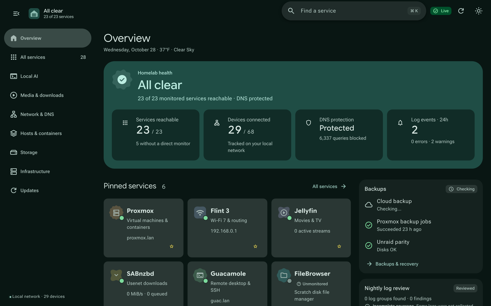
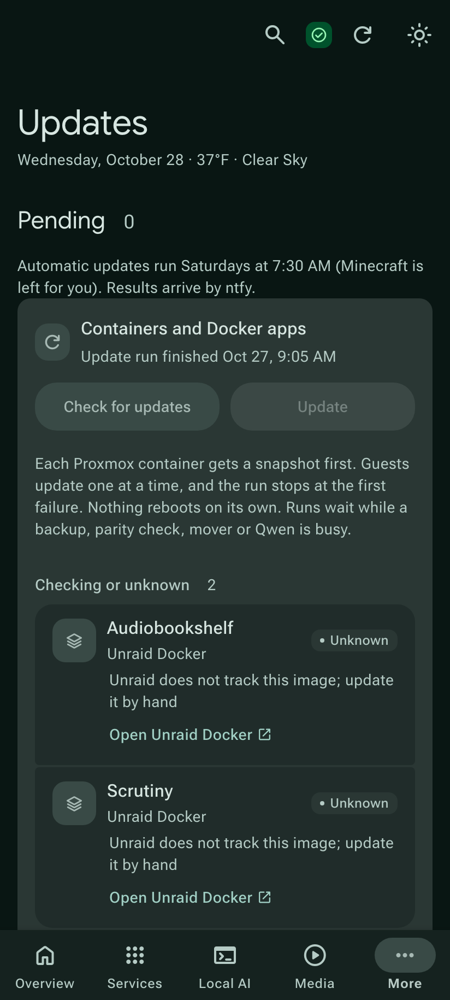

# Homelab Command Center

A custom React dashboard and telemetry aggregator for homelab infrastructure. Provides unified system status, real-time host and storage telemetry, service health catalogs, disk history, and local LLM integrations.

> 📄 **Project Showcase PDF:** A 4-page presentation is available at [**`showcase/Homelab_Command_Center_Showcase.pdf`**](showcase/Homelab_Command_Center_Showcase.pdf)



---

## Features

- **Unified Overview:** Real-time host metrics (CPU, RAM, thermals), status line, active VM/LXC counts, quick actions, and customizable quick-access pinned services. Unmonitored or failed sensors remain explicit unknowns ("missing data stays missing") rather than fabricated zeroes.
- **Storage & Disk Telemetry:** Tracks physical disk read/write throughput, Unraid array & cache status, cache fill forecasting, and disk I/O pressure via Glances AMP probes.
- **Service Catalog & Health:** Centralized catalog of 29 self-hosted services with real-time port/HTTP reachability checks and status badges.
- **Log Aggregator:** Groups recent syslog events by host, severity, and message, with inline expansion for long entries and automatic deduplication.
- **Local AI Integration:**
  - On-demand system queries using local Qwen models with verifiable system context evidence, presented in a slim, collapsible query box.
  - Integration with Open WebUI and local model routers.
  - Dedicated Arc A310 GPU monitoring (render, compute, VRAM, temperatures) folded directly into the Local AI view.
- **Guarded Updates:** Check and apply `apt` upgrades in running Proxmox LXCs and image updates for Unraid Docker apps from the **Updates** page. Each LXC is snapshotted first, guests update one at a time, and the run stops at the first failure.
- **Gaming PC Power:** Wake PC (Wake-on-LAN) and Sleep PC controls in Local AI. Sleep uses a single-purpose SSH key, displays a 60-second warning, and refuses while the GPU is active unless confirmed.
- **Phone Alerts:** ntfy push notifications for stale shares, failed services, stopped Docker apps, failed updates, stale speed tests, filling storage, drive health, and backups.
- **Mount Healing:** Automated systemd timer (`mount-heal`) to detect and recover stale CIFS/NFS mounts after array or network interruptions.

---

## Visual Showcase

### Storage Telemetry & Contention Analysis
Physical disk throughput, predictive cache exhaustion modeling, and I/O pressure tracking via Glances AMP probes:


### Local AI & Intel Arc A310 Acceleration
Unified GPU silicon telemetry (Render, Compute, Video engines, and VRAM) alongside local LLM benchmarks (Qwen 27B, Gemma 26B, MoE 35B) and Gaming PC power controls:


### Guarded Updates & Fleet Management
Inventory of 29 services, Proxmox LXCs/VMs, and Unraid Docker containers with snapshot-first apt upgrades:


### Responsive Mobile Interface
Optimized touch-friendly layouts for phones with one-tap quick actions, collapsible prompt drawer, and full update controls:
<p align="center">
  
  &nbsp;&nbsp;&nbsp;&nbsp;
  
</p>

---

## Architecture

- **Frontend:** React 18 single-page application built into an unbundled HTML payload. Supports responsive layouts from mobile (360px) to ultrawide (3440px).
- **Backend:** Lightweight Python service running on Proxmox (LXC 104), exposing `/api/telemetry`, `/api/storage`, and guarded action endpoints.
- **Data Persistence:** Rolling 24-hour metrics stored in a local SQLite database (`metrics.sqlite3`).
- **Telemetry Probes:** Custom Glances AMP probe (`host_probe.py`) reporting cumulative disk and system metrics at 10-second intervals.

---

## Development & Build

### Requirements
- Node.js (v18+)
- Python 3.10+
- Playwright (optional, for browser smoke tests)

### Build Commands
```sh
npm ci
npm run build
```

### Running Tests
```sh
# Unit tests
python3 -m unittest discover -v

# Local preview server (localhost:8799)
python3 preview.py

# UI smoke tests (Playwright)
node ui-smoke.mjs
```

---

## Deployment

The dashboard runs inside a Proxmox LXC container behind systemd (`homelab-dashboard.service`).

To deploy updates from the repository:
```sh
python3 deploy.py
```

`deploy.py` performs the following steps:
1. Backs up existing deployment files to `/opt/homelab-dashboard/backups/`.
2. Syncs the compiled `index.html` and backend patches to `/usr/local/bin/`.
3. Verifies Python syntax and runs health checks against the local API.
4. Automatically rolls back if health checks fail.

---

## Key Modules

| Module | Description |
| :--- | :--- |
| `src/app.jsx` | React UI components, navigation views, and responsive chart renderers. |
| `backend_patch.py` | Minimal hooks injected into the dashboard HTTP server for storage & telemetry APIs. |
| `storage_monitor.py` | Collects disk I/O, filesystem usage, and capacity metrics from Glances. |
| `activity_monitor.py` | Correlates download speeds (SABnzbd / RdtClient) with scratch disk I/O and PSI. |
| `log_monitor.py` | Collects, deduplicates, and groups alerts from the syslog monitor. |
| `cache_guard.py` | Monitors Unraid cache pool usage and triggers the mover at configurable thresholds. |
| `updates/` | Proxmox-side update runner (`homelab-update`), reached only through a restricted forced-command SSH key; `install.py` installs it. |
| `update_proxy.py` | Dashboard bridge for `/api/updates` (status, check, start). |
| `tools/` | Read-only diagnostics broker and Open WebUI tool (`overview`, summary, storage, services, guests, warnings). |
| `memos/` | Memos LXC setup and LAN proxy. |
| `mount-heal/` | Systemd service and timer to automatically remount stale network shares. |
| `nightly/` | Local LLM runner, GPU probes (`gpu_probe.py`), and context builders for on-demand queries. |

---

## Security & Access Control

- **Internal Only:** Designed to run strictly on the local private network (LAN/VPN) without public internet exposure.
- **Action Guard:** Sensitive actions (e.g. Pi-hole pauses, log clears) require a custom `X-Dashboard-Action` header and strict same-origin verification (`same_origin`).
- **Update Runner:** The dashboard holds one SSH key that Proxmox accepts only from the dashboard host and only for `status`, `check` and `start`. Runs refuse to start while a backup, parity check, mover or local model is busy.
- **Credentials:** No secrets or credentials are stored in the git repository or exposed to client browsers. All remote integrations load tokens from root-restricted configuration files on the host.

---

## License

MIT License
