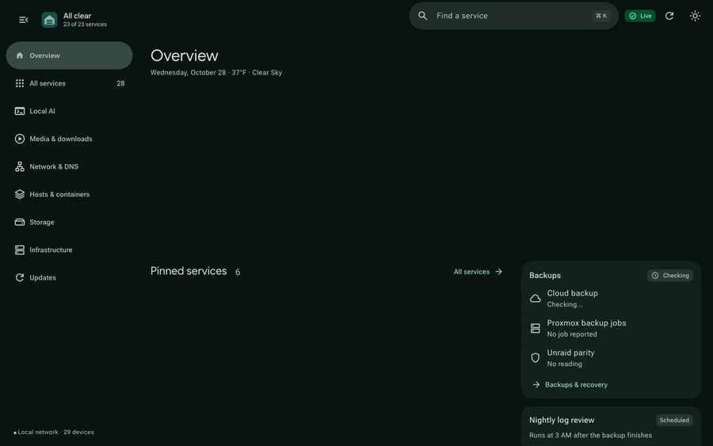
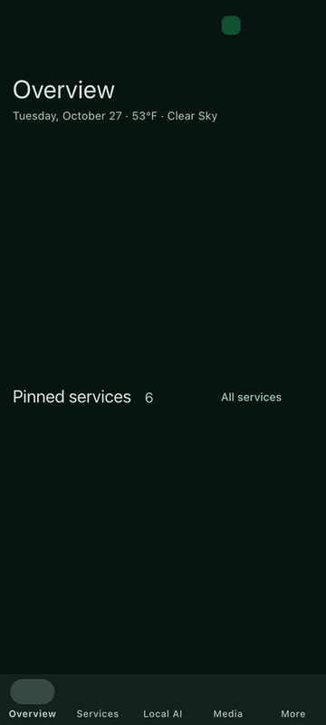

# Homelab Command Center

A React dashboard and telemetry service for a Proxmox and Unraid homelab. The first screen shows whether anything needs attention; dedicated pages cover services, storage, network, backups, updates, and local LLMs.



Sharper copies: [desktop MP4](showcase/motion-desktop.mp4), [phone MP4](showcase/motion-phone.mp4). The 8-page showcase PDF is at [`showcase/Homelab_Command_Center_Showcase.pdf`](showcase/Homelab_Command_Center_Showcase.pdf).

## Features

- **Health & Actions:** Immediate status ("All clear" or attention list) with health tiles that open their page, pinned services, and quick actions (wake/sleep gaming PC, pause Pi-hole, trigger updates).
- **Storage & Network:** Real-time throughput, disk latency, SMART health, and 24h rolling history in SQLite. Predicts Unraid cache fills and runs the mover proactively.
- **Local AI:** Real-time status for llama.cpp on the RTX 5070 Ti (with vision), live GPU power, temperature, load and VRAM from a tiny on-demand reader on the PC (`pc/gpu_metrics.py`), and a helper model on an Arc A310 for homelab queries and nightly log reviews. The model is left to sleep when idle, and a stuck generation is unloaded automatically.
- **Updates & Backups:** Container `apt` upgrades and Docker image pulls with automatic rollback snapshots. Tracks Proxmox backup jobs and Google Drive restic snapshots.
- **Mobile & Responsive:** Adapts from phones (bottom bar + More sheet) to ultrawides. Follows Material 3 Expressive motion and color tokens. The [Android app](https://github.com/roneill2000/homelab-android) wraps it with predictive back and haptics.

<p align="center">
  
  &nbsp;
  
  &nbsp;
  
</p>

## Development

Requires Node.js 18+ and Python 3.10+.

```sh
npm ci
npm run build          # writes index.html
python3 preview.py     # local preview on 127.0.0.1:8799
npm run check          # confirms index.html matches a fresh build, then 10 Playwright check suites
python3 -m unittest discover -v
```

To refresh the showcase screenshots, PDF, and clips (requires `ffmpeg`):

```sh
node showcase/build-showcase.mjs   # screenshots + PDF
node showcase/record-motion.mjs    # desktop and phone clips
```

## Deployment

Runs in a Proxmox LXC under systemd (`homelab-dashboard.service`):

```sh
python3 deploy.py
```

`deploy.py` backs up current files, updates `index.html` and backend patches, checks syntax and API health, and rolls back on failure.

## Security

- Runs on the local network/VPN only.
- State-changing actions require confirmation, a same-origin request, and an `X-Dashboard-Action` header.
- Content-Security-Policy with per-request nonces; embedded telemetry data is escaped.
- The page can't be framed by other sites, requests for unknown host names are refused (DNS rebinding), and idle connections time out.
- The syslog monitor serves only its own page and the dashboard: no cross-site reads, no cross-site clearing, and log names are limited to real hosts.
- Update runner uses a locked-down SSH key accepted only from the dashboard host.
- No secrets or API keys are stored in the repo or sent to the browser.

## License

MIT
