# Homelab Architecture Diagrams

Live-verified architecture diagrams for the homelab network, services, storage/backups, and operations.

Generated on **2026-10-22** from read-only inspection of Proxmox VE (`192.168.0.3`), Unraid 7.3.2 (`192.168.0.4`), Orange Pi Zero 2W (`192.168.0.10`), GL.iNet GL-BE9300 Router (`192.168.0.1`), and Gaming PC (`192.168.0.12`).

---

## 1. Diagrams Overview

### 01 · Network Topology & Routing (`01-network.svg`)
Shows the physical infrastructure, WAN edge (Comcast 2.5 Gbps), router subnets (LAN, isolated IoT, isolated Guest), WireGuard external ingress via VM 107, and primary/secondary DNS paths with `nebula-sync`.



---

### 02 · Services & Workloads (`02-services.svg`)
Grouped by physical host. Every running guest (LXC container, QEMU VM, or Docker container) is mapped with its static IP and main service ports. Stopped VMs and stopped containers are rendered dashed and grey.



---

### 03 · Data, Storage & Backups (`03-data-backup.svg`)
Covers local disks, CIFS/NFS network mounts, daily local snapshot rotations (`vzdump`), and daily encrypted off-site cloud uploads (`restic` to Google Drive).



---

### 04 · Operations, Telemetry & AI Routing (`04-ops.svg`)
Visualizes telemetry feeds into Homepage (`192.168.0.2`), central syslog shipping via UDP 514 to Proxmox and the syslog web viewer (`:8999`), 10 alert senders routing through `ntfy.sh` to mobile/watch, external heartbeat via `healthchecks.io`, and dual-tier local AI inference routing (Intel Arc A310 vs RTX 5070 Ti).



---

## 2. Live Inventory Differences & Verification Notes

Collection timestamp: `2026-10-22T12:57:00Z` (recorded in [`inventory.json`](inventory.json)).

Differences observed against initial expectations:
1. **LXC 103 (`kasm`, 192.168.0.15):** Observed in `running` state (previously noted as usually stopped).
2. **Proxmox Hypervisor:** Verified running **Proxmox VE 9.2.21** on Linux kernel `7.0.14-24-pve`.
3. **Gaming PC (`192.168.0.12`):** Verified online during scan, actively listening on port `8080` (llama.cpp multi-model router).
4. **Unraid Containers:** 6 running containers confirmed (`itzg-minecraft-server`, `Jellyfin`, `Glances`, `Scrutiny`, `Audiobookshelf`, `unraid-restic`), with 2 intentionally stopped (`zurg` exited 0, `Transcoding-GPU-Benchmark` exited 0).
5. **Orange Pi Zero 2W:** Running vendor kernel `6.1.31-sun50iw9` on Ubuntu 26.04 LTS; `pihole-FTL`, `nebula-sync` (Docker), and `uptime-kuma` (Docker) verified healthy.
6. **Subnet Isolation:** IoT (`192.168.10.0/24`) and Guest (`192.168.9.0/24`) are isolated VLAN bridges on the router; individual client devices are marked as unverified per homelab policy.

---

## 3. How to Regenerate

Prerequisites: Node.js and `@mermaid-js/mermaid-cli`.

Run the following from the repository root:
```bash
cd diagrams
for f in 01-network 02-services 03-data-backup 04-ops; do
  npx -y @mermaid-js/mermaid-cli@11.4.2 -p puppeteer-config.json -i "$f.mmd" -o "$f.svg" -b transparent
done
```
